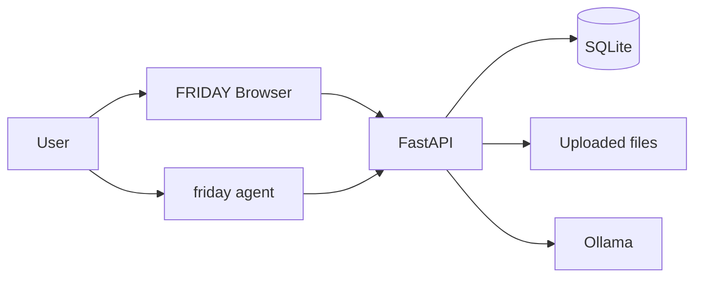

# FRIDAY Browser and Agent

FRIDAY is a local-first workspace for browsing and searching your documents, managing project knowledge, and running an approval-based coding agent.

## Start

Use the installer for a new machine:

```powershell
irm https://raw.githubusercontent.com/veer-bajpai/FRIDAY-Local-First-AI-Knowledge-Assistant/main/install.ps1 | iex
```

On macOS or Linux:

```bash
curl -fsSL https://raw.githubusercontent.com/veer-bajpai/FRIDAY-Local-First-AI-Knowledge-Assistant/main/install.sh | bash
```

Open a new terminal, then run:

```sh
friday browser
friday agent
```

`friday` starts Browser by default. `friday agent -p "task"` runs one coding-agent task and exits. `friday setup` prepares dependencies and local models; `friday update` updates a Git checkout. Use `friday --help` for launcher options.

Requirements: Git, Node.js 20+, Python 3.11+, and Ollama. Setup installs the application dependencies and pulls the configured agent and embedding models. The Windows installer requires `winget`; macOS uses Homebrew; Linux supports `apt`, `dnf`, or `pacman`.

## Browser

FRIDAY Browser is the local web workspace at `http://localhost:3000`. It provides:

- Document upload, indexing, status, and reprocessing
- Hybrid document search, collections, and long-term memories
- Activity, local service health, and settings
- A browser panel for inspecting and running coding-agent sessions

Documents are processed locally by FastAPI. PDF, Office, text, code, CSV, JSON, HTML, and image uploads are supported; scanned PDFs and images can use optional OCR and a local vision model.

## Coding Agent

The coding agent runs in the terminal with `friday agent` or in Browser's Agent panel. It can inspect and edit a selected project, run tools, and keep resumable sessions. File edits, shell commands, git changes, and network operations follow the configured approval policy.

Optional MCP and voice integrations are installed with `pip install -r backend/requirements-agent-optional.txt`. See [operations and security](docs/operations.md) for configuration and safety details.

## Local Services and Data

| Service | Default address          | Role                                                      |
| ------- | ------------------------ | --------------------------------------------------------- |
| Next.js | `http://localhost:3000`  | Browser workspace                                         |
| FastAPI | `http://localhost:8000`  | Documents, search, memory, and agent APIs                 |
| Ollama  | `http://localhost:11434` | Agent model, optional embeddings, and image understanding |

SQLite data and uploaded files are stored under `~/.friday/data` when started by the CLI. Set `FRIDAY_DATA_DIR` to use another directory. Ollama requests go to `OLLAMA_URL`.



## Development

Install frontend and backend dependencies with `npm ci` and `pip install -r backend/requirements.txt`. Set `NEXT_PUBLIC_API_URL=http://localhost:8000` in `.env.local`, start FastAPI from `backend/`, then run `npm run dev` from the repository root.

Run the checks with:

```sh
npm run lint
npm run build
pytest
```

See [the architecture guide](docs/architecture.md), [operations guide](docs/operations.md), and [backend guide](backend/README.md) for implementation and API details.
