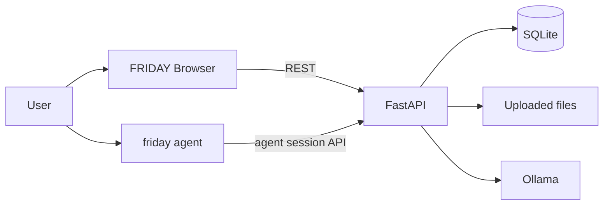

# FRIDAY Architecture

FRIDAY has two user-facing clients: Browser for documents and workspace data, and the coding agent for project work. There is no standalone conversation UI or terminal chat client.

## Runtime Components

| Component       | Default address          | Responsibility                                                                    |
| --------------- | ------------------------ | --------------------------------------------------------------------------------- |
| Next.js Browser | `http://localhost:3000`  | Documents, search, collections, memories, activity, settings, and the Agent panel |
| FastAPI         | `http://localhost:8000`  | Document ingestion, retrieval, persistence, health, and agent sessions            |
| Ollama          | `http://localhost:11434` | Agent model calls and optional embeddings/vision processing                       |
| Friday Agent    | `friday agent`           | Terminal coding-agent console connected to the local API                          |

The launcher installs dependencies and models with `friday setup`. `friday` and `friday browser` start Browser; `friday agent` starts the independent coding-agent console. The launcher binds local services to loopback by default. Stop managed services with `Ctrl+C`.

## Browser and API

The App Router UI is under `src/app/`. The page loads documents, activity, collections, memories, agent sessions, settings, and health from FastAPI. Browser interactions use REST endpoints; agent sessions use the `/api/agent/*` routes.

The API and persistent data are shared by Browser and the coding agent. SQLite stores documents, chunks, activity, collections, settings, and long-term memories. Uploaded sources are stored under `<FRIDAY_DATA_DIR>/uploads/`. New databases no longer create conversation or message tables. Older databases are not destructively rewritten; any legacy conversation tables are unused.

### Document ingestion

`backend/app/extraction.py` handles PDF, Office, CSV/TSV, JSON, HTML, Markdown, text, and code. Scanned pages can use Tesseract OCR. Images can use OCR and/or a local Ollama vision model. The API saves upload metadata, extracts text, chunks content, and stores chunks with optional embeddings. Interrupted processing is re-queued at startup.

### Search

`backend/app/knowledge.py` combines SQLite FTS5 lexical candidates with an in-memory vector index when stored embeddings are available. Results include document, chunk, page, method, and score metadata. Without embeddings, search continues with FTS5. Collections and document ID filters constrain results.

### Memory

Long-term memories can be created, updated, deleted, listed, and searched through `/api/memories`. Memories are separate from agent session transcripts and do not depend on a conversation UI.

## Coding Agent

`friday_agent/engine.py` implements the maintained agent loop behind `/api/agent/sessions`. It supports persistent sessions, approvals, per-tool timeouts, repeated-failure protection, context trimming, and a repository map. The terminal console is launched by `bin/agent.js`; the Browser Agent panel uses the same session API.

`backend/app/agent/loop.py` is a legacy `/api/agent/stream` loop retained for external clients. The bundled clients use the maintained session API.

File tools stay within the selected project workspace. File changes, shell commands, git mutations, and network operations follow agent permissions and approval prompts.

## API Surface

| Method            | Path                                      | Purpose                                               |
| ----------------- | ----------------------------------------- | ----------------------------------------------------- |
| `GET`             | `/health`, `/api/health`                  | Liveness and dependency readiness                     |
| `GET`, `PUT`      | `/api/settings`                           | Embedding model and retrieval settings                |
| `GET`, `POST`     | `/api/documents`, `/api/documents/upload` | List and ingest documents                             |
| `GET`, `DELETE`   | `/api/documents/{id}`                     | Read or delete a document                             |
| `POST`            | `/api/documents/{id}/reprocess`           | Reprocess a document                                  |
| `POST`            | `/api/search`                             | Hybrid document search                                |
| `GET`, `POST`     | `/api/collections`                        | List or create collections                            |
| `GET`, `POST`     | `/api/memories`                           | List, search, or create long-term memories            |
| `PATCH`, `DELETE` | `/api/memories/{id}`                      | Update or delete a memory                             |
| `GET`             | `/api/activity`                           | Recent workspace activity                             |
| `/api/agent/*`    | Multiple                                  | Agent sessions, turns, approvals, history, and health |

The standalone `/api/chat`, `/api/chat/stream`, `/api/conversations`, `/api/models`, and `/api/status` endpoints are not part of the current application.

## Deployment and Configuration

The CLI starts Next.js and FastAPI locally. `docker-compose.yml` provides containerized Ollama, FastAPI, and Browser services. Default ports are 3000, 8000, and 11434.

| Variable                     | Purpose                                                           |
| ---------------------------- | ----------------------------------------------------------------- |
| `NEXT_PUBLIC_API_URL`        | FastAPI URL used by Browser                                       |
| `FRIDAY_DATA_DIR`            | SQLite database, uploads, agent sessions, and API token directory |
| `OLLAMA_URL` / `OLLAMA_HOST` | Ollama server URL                                                 |
| `FRIDAY_MODEL`               | Default coding-agent model                                        |
| `FRIDAY_EMBED_MODEL`         | Default embedding model                                           |
| `FRIDAY_FALLBACK_MODELS`     | Agent model fallback order                                        |
| `FRIDAY_VISION_MODEL`        | Optional image understanding model                                |
| `FRIDAY_ALLOWED_ORIGINS`     | Additional CORS origins                                           |

Security and operational details are in [operations.md](operations.md). The vector database prototype in `main.cpp` is not a runtime dependency.
